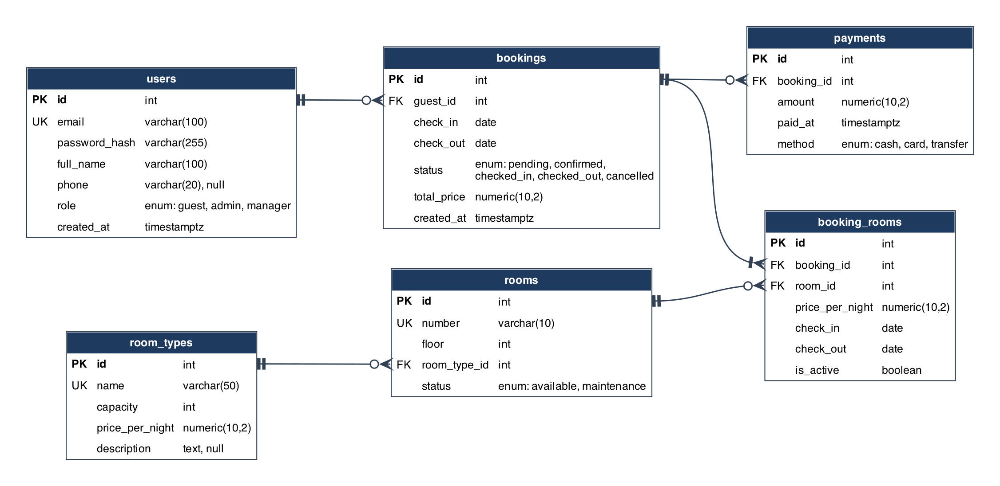

### ТЗ: Система бронирования номеров отеля «HotelBooking»

Версия от 25.10.2026. Рабочая копия ТЗ ведётся в общем документе, этот файл повторяет её содержание.

### 1. Название и назначение системы

**Название:** HotelBooking, система бронирования номеров отеля.

**Назначение:** автоматизация бронирования номерного фонда небольшого отеля: поиск свободных номеров на диапазон дат, оформление и отмена брони, заселение и выселение гостей, учёт оплат и отчёты по загрузке. Система заменяет ручной учёт в журнале или таблице и исключает двойное бронирование одного номера на пересекающиеся даты.

**AS IS:** учёт броней ведётся вручную (журнал или электронная таблица): поиск свободного номера требует сверки записей, возможны двойные брони, нет истории статусов и отчётности.

**TO BE:** единая система с API: доступность номера проверяется автоматически, двойное бронирование исключено на уровне БД, статусы и оплаты фиксируются, отчёты строятся по накопленным данным.

### 2. Пользователи и роли

| Роль | Задачи |
| --- | --- |
| Гость | Регистрация и вход; поиск свободных номеров по датам и категории; создание брони; просмотр и отмена своих броней |
| Администратор (ресепшен) | Подтверждение и отклонение броней; заселение и выселение; регистрация оплаты; создание брони от имени гостя (по телефону) |
| Менеджер | Управление номерным фондом (номера, категории, цены); отчёты по загрузке и выручке; управление учётными записями персонала |

### 3. Основные бизнес-процессы

1. **Поиск свободных номеров.** Гость задаёт даты заезда и выезда, вместимость и категорию; система показывает номера без пересекающихся активных броней на этот диапазон.
2. **Создание брони.** Гость (или администратор по телефону) выбирает номер и даты; система проверяет отсутствие конфликта дат, считает стоимость и создаёт бронь в статусе «ожидает подтверждения».
3. **Подтверждение и оплата.** Администратор подтверждает бронь; фиксируется оплата (полная или предоплата), бронь переходит в статус «подтверждена».
4. **Заселение и выселение.** В день заезда администратор отмечает заселение (check-in), в день выезда выселение (check-out); номер освобождается для новых броней.
5. **Отмена брони.** Гость отменяет свою бронь до даты заезда; администратор может отменить любую незавершённую бронь (неявка, форс-мажор).
6. **Отчётность.** Менеджер получает отчёты: загрузка номерного фонда за период, выручка, список заездов и выездов на день.

### 4. Функциональные требования

| № | Требование | Приоритет |
| --- | --- | --- |
| FR-1 | Система должна позволять регистрировать пользователя и аутентифицировать его (JWT) | Must |
| FR-2 | Система должна разграничивать доступ по ролям: гость / администратор / менеджер | Must |
| FR-3 | Система должна позволять менеджеру вести справочник категорий номеров (название, вместимость, цена за ночь) | Must |
| FR-4 | Система должна позволять менеджеру вести номерной фонд (номер, этаж, категория, состояние) | Must |
| FR-5 | Система должна возвращать список свободных номеров на заданный диапазон дат с фильтром по категории и вместимости | Must |
| FR-6 | Система должна позволять создать бронь на номер с датами заезда и выезда и автоматически рассчитывать стоимость | Must |
| FR-7 | Система должна запрещать создание брони, пересекающейся по датам с активной бронью того же номера | Must |
| FR-8 | Система должна позволять гостю просматривать и отменять свои брони до даты заезда | Must |
| FR-9 | Система должна позволять администратору подтверждать и отклонять брони | Must |
| FR-10 | Система должна позволять администратору отмечать заселение (check-in) и выселение (check-out) | Must |
| FR-11 | Система должна фиксировать оплаты по брони (сумма, дата, способ) | Should |
| FR-12 | Система должна отправлять уведомление о смене статуса брони по WebSocket подключённым клиентам | Should |
| FR-13 | Система должна формировать отчёт о загрузке номерного фонда за период | Should |
| FR-14 | Система должна показывать администратору список заездов и выездов на выбранный день | Should |
| FR-15 | Система должна вести историю изменений статуса брони (кто и когда изменил) | Nice to have |

### 5. Нефункциональные требования

- **Производительность:** до 50 одновременных пользователей; время отклика API не более 500 мс на типовой запрос (поиск номеров, CRUD).
- **Безопасность:** аутентификация по JWT; пароли хранятся в виде bcrypt-хэшей; разграничение прав доступа на уровне эндпоинтов по ролям; валидация всех входных данных.
- **Надёжность:** сервер не должен падать от некорректных запросов клиента (любая ошибка возвращается как корректный HTTP-код и JSON с описанием); ежедневный бэкап БД; допустимый простой до 1 часа в сутки (ночное окно).
- **Масштабируемость:** stateless-сервер (состояние только в БД), что позволяет запустить несколько экземпляров за балансировщиком при росте нагрузки.
- **Сопровождаемость:** схема БД версионируется миграциями (Alembic) вместе с кодом; API документируется автоматически (OpenAPI/Swagger).

### 6. Границы системы

**In Scope:**

- учёт номерного фонда и категорий;
- поиск свободных номеров, бронирование, отмена;
- подтверждение броней, заселение и выселение;
- учёт оплат (запись факта оплаты, без эквайринга);
- уведомления о смене статуса брони (WebSocket);
- отчёты по загрузке и выручке.

**Out of Scope:**

- онлайн-оплата через платёжные шлюзы;
- интеграция с каналами продаж (Booking.com, Ostrovok) и channel-менеджерами;
- мобильное приложение и проработанный UI (по условиям курса достаточно API + Swagger/Postman);
- программа лояльности, email-рассылки.

**Внешние интеграции:** отсутствуют (автономная система).

### 7. Технологический стек и протоколы

| Слой | Технология |
| --- | --- |
| СУБД | PostgreSQL 16 |
| Backend | Python 3.12, FastAPI, SQLAlchemy 2.x, Alembic (миграции), Pydantic (валидация) |
| Протокол 1 | HTTP/REST (JSON); демонстрация через Swagger UI (встроен в FastAPI) и Postman |
| Протокол 2 | WebSocket: push-уведомления клиентам о смене статуса брони |
| Тесты | pytest + httpx (интеграционные тесты API), тесты граничных случаев и ошибок |
| Репозиторий | Git (GitHub), схема БД и миграции версионируются вместе с кодом |

Клиент: Swagger UI и Postman как основной способ демонстрации; дополнительно минимальная HTML-страница с подпиской на WebSocket для показа уведомлений вживую.

### 8. Модель данных (ER)



Нотация Crow's Foot. Исходник диаграммы: [er/er-diagram.dot](er/er-diagram.dot) (Graphviz), описание схемы на DBML: [er/hotel_booking.dbml](er/hotel_booking.dbml).

booking_rooms является ассоциативной сущностью: разрешает связь M:N между бронью и номерами (одна бронь может включать несколько номеров) и хранит цену за ночь на момент брони. Это осознанная денормализация для историчности: цена в room_types может меняться.

**Ключевое бизнес-ограничение:** для одного номера не может существовать двух активных броней (статусы «ожидает», «подтверждена», «заселён») с пересекающимися интервалами [check_in, check_out). Проверяется на уровне приложения при создании брони и подкрепляется в БД exclusion constraint PostgreSQL (btree_gist, daterange). Интервал полуоткрытый: день выезда одного гостя может быть днём заезда следующего.

Все таблицы в 3НФ. Отступления: price_per_night в booking_rooms и total_price в bookings (обоснованная денормализация, см. выше), а также служебные колонки check_in, check_out, is_active в booking_rooms, которые поддерживает триггер ради exclusion constraint.

### 9. Бизнес-правила

1. Интервал брони полуоткрытый [check_in, check_out): день выезда одного гостя может быть днём заезда следующего.
2. check_out строго позже check_in; при создании брони check_in не может быть в прошлом.
3. Активными считаются брони в статусах pending, confirmed, checked_in: только они участвуют в проверке пересечений; cancelled и checked_out конфликтов не создают.
4. Для одного номера не может существовать двух активных броней с пересекающимися интервалами (контроль в приложении + exclusion constraint в БД).
5. Гость отменяет только свою бронь и только до даты заезда; администратор отменяет любую незавершённую бронь.
6. Стоимость = число ночей × цена категории на момент создания брони; фиксируется в booking_rooms.price_per_night и bookings.total_price и не меняется при смене тарифа.
7. Допустимые переходы статусов: подтверждение из pending, заселение из confirmed, выселение из checked_in, отмена из pending или confirmed. Терминальные статусы: checked_out и cancelled; из checked_in отмена уже невозможна.
8. Номер в статусе maintenance не участвует в поиске и не бронируется.
9. Email пользователя уникален; пароль хранится только как bcrypt-хэш.

### 10. Матрица прав доступа

| Операция | Гость | Администратор | Менеджер |
| --- | --- | --- | --- |
| Регистрация, вход | ✓ | ✓ | ✓ |
| Поиск свободных номеров | ✓ | ✓ | ✓ |
| Создание брони | ✓ (своя) | ✓ (любая, в т.ч. по телефону) | — |
| Просмотр броней | ✓ (только свои) | ✓ (все) | ✓ (все) |
| Отмена брони | ✓ (своя, до заезда) | ✓ (любая незавершённая) | — |
| Подтверждение, заселение, выселение | — | ✓ | — |
| Фиксация оплаты | — | ✓ | — |
| Управление номерами и категориями | — | — | ✓ |
| Отчёты по загрузке и выручке | — | ✓ (заезды/выезды на день) | ✓ (все отчёты) |
| Управление учётными записями персонала | — | — | ✓ |

### 11. Спецификация REST API

Базовый формат: JSON; аутентификация через заголовок `Authorization: Bearer <JWT>`; ошибки возвращаются как JSON вида `{"detail": "..."}`. Списки поддерживают пагинацию skip/limit.

| Метод и путь | Назначение | Доступ | Коды |
| --- | --- | --- | --- |
| POST /auth/register | Регистрация гостя | публично | 201, 400 (email занят) |
| POST /auth/login | Вход, выдача JWT | публично | 200, 401 |
| GET /room-types | Список категорий номеров | все авторизованные | 200 |
| POST /room-types | Создать категорию | менеджер | 201, 400 |
| PUT /room-types/{id} | Изменить категорию | менеджер | 200, 404 |
| DELETE /room-types/{id} | Удалить категорию | менеджер | 204, 404, 409 (есть номера) |
| GET /rooms | Номерной фонд (пагинация, фильтры) | админ, менеджер | 200 |
| GET /rooms/available | Свободные номера: check_in, check_out, capacity, room_type_id | все авторизованные | 200, 400 (некорректные даты) |
| POST /rooms | Создать номер | менеджер | 201, 400 (номер занят) |
| PATCH /rooms/{id} | Изменить номер (этаж, категория, статус) | менеджер | 200, 404 |
| DELETE /rooms/{id} | Удалить номер | менеджер | 204, 404, 409 (активные брони) |
| POST /bookings | Создать бронь | гость (своя), админ (любая) | 201, 400, 409 (пересечение дат) |
| GET /bookings | Брони (пагинация, фильтр по статусу и датам) | гость: свои; админ, менеджер: все | 200 |
| GET /bookings/{id} | Бронь по id | владелец, админ, менеджер | 200, 403, 404 |
| POST /bookings/{id}/confirm | Подтвердить бронь | админ | 200, 404, 409 (неверный статус) |
| POST /bookings/{id}/check-in | Заселение | админ | 200, 404, 409 |
| POST /bookings/{id}/check-out | Выселение | админ | 200, 404, 409 |
| POST /bookings/{id}/cancel | Отмена | гость (свою, до заезда), админ | 200, 403, 404, 409 |
| POST /bookings/{id}/payments | Зафиксировать оплату | админ | 201, 400, 404 |
| GET /bookings/{id}/payments | Оплаты по брони | владелец, админ, менеджер | 200, 404 |
| GET /reports/occupancy | Загрузка фонда за период: from, to | менеджер | 200, 400 |
| GET /reports/day | Заезды и выезды на день: date | админ, менеджер | 200 |

PUT и PATCH для справочников (room_types, rooms) поддерживают оба варианта обновления; смена статусов брони вынесена в отдельные действия (confirm, check-in, check-out, cancel), а не в общий PATCH: так валидируются переходы.

### 12. Спецификация WebSocket (второй протокол)

- **Эндпоинт:** `WS /ws/bookings`; аутентификация через JWT в query-параметре token (или первым сообщением после подключения).
- **Направление:** сервер → клиент (push); клиент может отправлять ping для поддержания соединения.
- **Событие booking.status_changed** отправляется при любой смене статуса брони:

```json
{
  "event": "booking.status_changed",
  "booking_id": 17,
  "old_status": "pending",
  "new_status": "confirmed",
  "timestamp": "2026-11-02T14:05:30Z"
}
```

- **Адресация:** гость получает события только своих броней; администратор и менеджер получают все.
- **Демонстрация:** минимальная HTML-страница с подключением к WS и логом событий; сценарий: страница открыта, админ подтверждает бронь через Swagger, уведомление появляется на странице без перезагрузки.

### 13. Ограничения

- **Технологические:** стек зафиксирован разделом 7 (PostgreSQL 16, Python 3.12, FastAPI); развёртывание локально или в Docker Compose (api + db); внешние платёжные и почтовые сервисы не используются.
- **Правовые:** система хранит минимум персональных данных (ФИО, email, телефон); все тестовые данные вымышленные; при реальной эксплуатации потребуется соответствие 152-ФЗ «О персональных данных» (согласие на обработку, защита хранения).

### 14. Этапы разработки и порядок приёмки

| Этап | Результат |
| --- | --- |
| 1. ТЗ, ER, схема БД | Этот документ, DDL/DML-скрипты, диаграмма |
| 2. Каркас backend | Структура проекта, ORM-модели, миграции Alembic, seed, репозиторий |
| 3. CRUD + REST | Эндпоинты CRUD, Swagger, Postman-коллекция |
| 4. Бизнес-логика | Поиск свободных номеров, брони со статусами, JWT и роли, отчёты |
| 5. WebSocket + тесты | Уведомления, pytest (граничные и типовые случаи) |
| 6. Устойчивость | Тесты на ошибки, CI, нагрузочный тест |

**Порядок приёмки:** работа REST через Swagger UI и Postman-коллекцию; второй протокол через HTML-страницу с живыми WebSocket-уведомлениями; тесты прогоном pytest; код по ссылке на удалённый репозиторий.

### 15. Требования к документированию

- README в репозитории: установка, .env.example, запуск (uvicorn), миграции (alembic upgrade head), наполнение тестовыми данными, запуск тестов.
- Автодокументация API: Swagger /docs с описаниями эндпоинтов (docstrings).
- Postman-коллекция, экспортированная в JSON, хранится в репозитории.
- ER-диаграмма (PNG/SVG) и SQL-скрипты хранятся в репозитории рядом с миграциями.
- Комментарии к нетривиальным местам: exclusion constraint, проверка пересечения дат, переходы статусов.

### 16. Глоссарий

| Термин | Определение |
| --- | --- |
| Бронь | Заявка гостя на проживание в одном или нескольких номерах на диапазон дат |
| Категория номера | Тип номера с вместимостью и базовой ценой за ночь (Стандарт, Люкс и т.д.) |
| Номерной фонд | Совокупность всех номеров отеля |
| Активная бронь | Бронь в статусе pending, confirmed или checked_in |
| Полуоткрытый интервал | [check_in, check_out): ночь дня выезда в бронь не входит |
| Заселение (check-in) | Отметка администратора о фактическом заезде гостя |
| Выселение (check-out) | Отметка администратора о выезде; номер освобождается |
| Двойное бронирование | Две активные брони одного номера с пересекающимися датами; запрещено системой |
